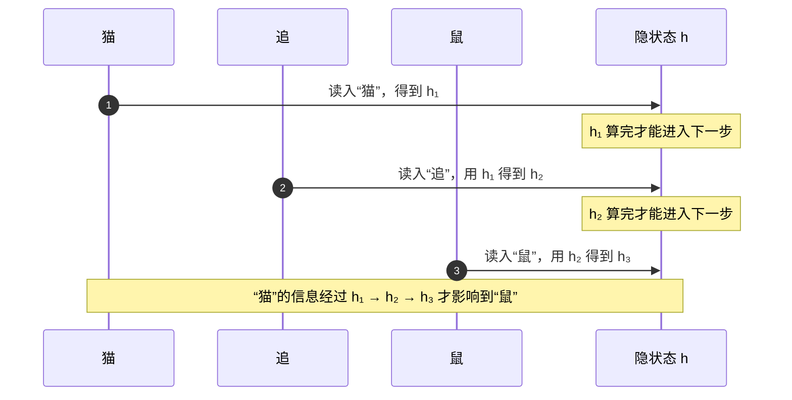
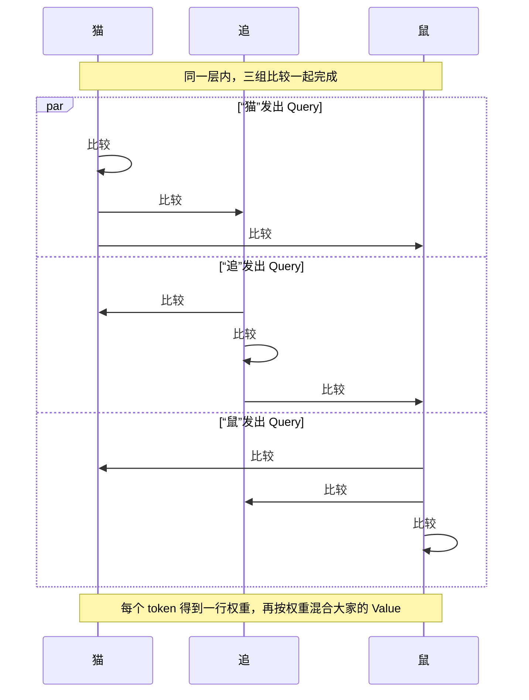
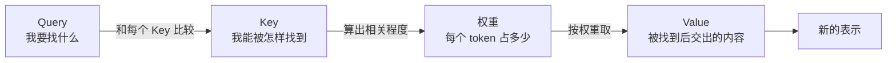
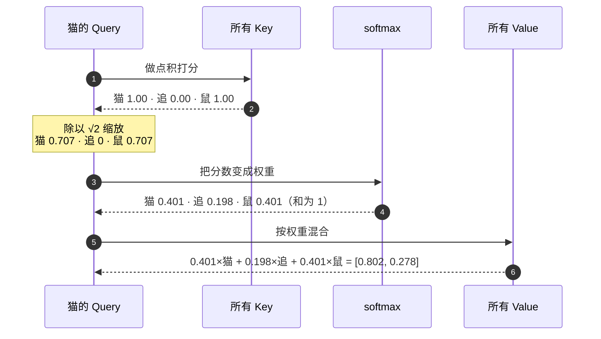
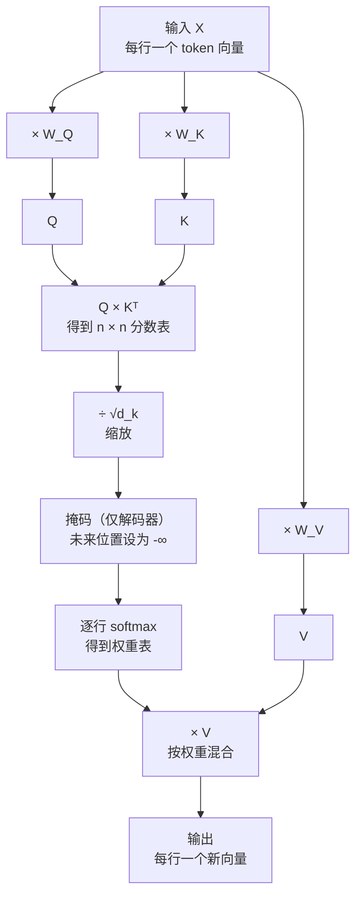
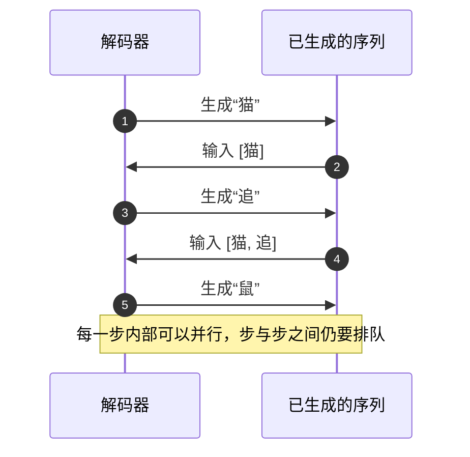
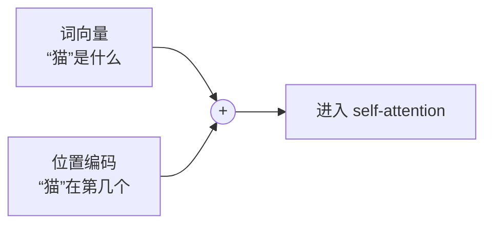

# Self-attention

Self-attention（自注意力）让一句话里的每个 token 直接去“看”其他 token，按相关程度把别人的信息混进自己的表示。它是 Transformer 的核心组件，取代了循环神经网络里一步接一步传递上下文的做法。

下面全程用一句三个 token 的例子：“猫 追 鼠”。

## 先记住这几点

- 循环层按顺序处理 token，“猫”的信息要经过“追”才能到“鼠”。
- Self-attention 让任意两个 token 在同一层直接建立联系，所有位置可以一起算。
- 每个 token 会生成三个向量：Query（我要找什么）、Key（我能被怎样找到）、Value（被找到后交出什么）。
- 注意力只看内容不看顺序，模型需要额外的位置编码。
- 代价是计算量随句子长度平方增长，长序列会变贵。

## 循环层：上下文排队传递

循环神经网络只维护一个隐状态 `h`。每读一个 token，就用旧的 `h` 和新 token 算出新的 `h`。第 2 步必须等第 1 步算完，第 3 步必须等第 2 步算完：



这带来两个问题：

- **慢**：同一句话内部无法并行，句子越长，要排队的步数越多。不同句子的同一步仍然可以组成批次一起算，但显存限制了批次能放多大。
- **远距离关系难学**：“猫”的信息要穿过所有中间步骤才能到达“鼠”。论文指出，两个位置之间的信号路径越长，模型越难学到它们之间的依赖。

## Self-attention：所有 token 同时互看

Self-attention 不再排队。每个 token 拿自己的 Query 去和所有 token 的 Key 比较（包括自己），三个 token 的比较在同一层同时发生：



两种方式的区别：

| | 循环层 | Self-attention |
| --- | --- | --- |
| 同一句内的计算顺序 | 逐个 token 排队 | 所有 token 一起算 |
| “猫”到“鼠”的距离 | 要经过中间每一步 | 一步直达 |
| 记住上下文的方式 | 压进一个不断被覆盖的隐状态 | 每次都直接回看整句 |

## Query、Key、Value 是什么

可以把它类比成一次检索：



- **Query**：当前 token 发出的“查询”。
- **Key**：每个 token 挂出的“标签”，用来和 Query 匹配。
- **Value**：每个 token 真正提供的内容，匹配度越高，被取走的越多。

三者都来自同一个 token 的向量，只是分别乘上三组不同的矩阵。这三组矩阵是训练学出来的，模型借此学会“该找什么”“该被怎样找到”“该交出什么”。Q、K、V 都来自同一句话，所以叫“自”注意力。

## 跟着“猫”走一遍

为了让数字容易看懂，下面用手写的二维向量，并且让 Query、Key、Value 都直接等于这些向量（相当于三组矩阵都是单位矩阵）：

| token | 向量 | 说明 |
| --- | --- | --- |
| 猫 | `[1, 0]` | 和“鼠”方向接近 |
| 追 | `[0, 1]` | 和另外两个几乎垂直 |
| 鼠 | `[1, 0.2]` | 和“猫”方向接近 |

“猫”算出新表示的完整过程：



每一步在做什么：

1. **打分**：点积越大，两个向量方向越接近。“猫”和“鼠”方向相近，得分高；和“追”垂直，得分为 0。
2. **缩放**：分数除以 Key 维度的平方根。原因放在后面讲。
3. **归一化**：softmax 把分数变成一组加起来为 1 的权重。分数高的拿到更多份额，但低分也不会完全归零。
4. **混合**：用权重对所有 Value 加权求和。“猫”的新向量里带进了不少“鼠”的成分。

## 整句的注意力权重

三个 token 都做一遍，就得到一张 3 × 3 的权重表。每一行是一个 token 分给所有 token 的注意力，行和为 1：

| Query ＼ Key | 猫 | 追 | 鼠 |
| --- | --- | --- | --- |
| **猫** | `████░ 0.401` | `██░░░ 0.198` | `████░ 0.401` |
| **追** | `██░░░ 0.239` | `█████ 0.485` | `███░░ 0.276` |
| **鼠** | `████░ 0.385` | `██░░░ 0.219` | `████░ 0.396` |

- “猫”和“鼠”互相关注得多，因为它们的向量接近。
- “追”和谁都不像，权重最大的是它自己。

真实模型里这张表是一次矩阵乘法算出来的：所有 Query 叠成矩阵 Q，所有 Key 叠成矩阵 K，`Q × Kᵀ` 一次给出整张分数表。这正是 GPU 擅长的运算，所以所有位置可以并行。

## 一层里的完整流水线

把上面的步骤连起来，就是论文里的缩放点积注意力：



整条流水线可以浓缩成论文里的一行公式：

```text
Attention(Q, K, V) = softmax(Q × Kᵀ / √d_k) × V
```

### 为什么要除以 √d_k

`d_k` 是 Key 向量的长度。向量越长，点积是越多项相加的结果，数值往往越大。分数差距一大，softmax 会把几乎全部权重压给最大的那一项，其余接近 0；这时 softmax 的梯度非常小，模型很难继续学习。除以 √d_k 把分数拉回比较温和的范围。

## 解码器：不许偷看后面

生成文本时，模型在写第 2 个词时还不知道第 3 个词。为了让训练和生成一致，解码器里的 self-attention 会在 softmax 之前把“未来位置”的分数设为负无穷，softmax 后这些位置的权重就是 0：

| Query ＼ Key | 猫 | 追 | 鼠 |
| --- | --- | --- | --- |
| **猫** | ✅ | ❌ | ❌ |
| **追** | ✅ | ✅ | ❌ |
| **鼠** | ✅ | ✅ | ✅ |

训练时整句已知，有了这个掩码，三行仍然可以一起算。真正生成时，下一个词要等上一个词生成出来，所以生成过程仍然是逐步的：



## 注意力不认识顺序

注意力只比较向量内容。如果把“猫追鼠”换成“鼠追猫”，每个 token 和其他 token 的比较结果完全一样，只是表格的行列换了位置，模型分不出谁追谁。

所以 Transformer 会在输入时给每个位置加上一个位置编码，让同一个词出现在不同位置时向量不同：



论文使用正弦函数生成的固定位置编码，也试过可学习的位置向量，两者效果接近。

## 代价：句子越长越贵

每个 token 都要和所有 token 比较，n 个 token 就要算 n × n 个分数。句子长度翻倍，分数表变成 4 倍。

论文第 4 节的对比（n 是序列长度，d 是向量维度）：

| 层 | 每层计算量 | 同一句内必须排队的步数 | 任意两个 token 之间的距离 |
| --- | --- | --- | --- |
| Self-attention | O(n² · d) | O(1) | O(1) |
| 循环层 | O(n · d²) | O(n) | O(n) |

当句子长度 n 小于向量维度 d 时（机器翻译里的常见情况），self-attention 反而更省。句子很长时 n² 会成为瓶颈，论文提出过只让每个 token 看附近一段范围的思路，并留作后续工作。

## 动手跑一跑

下面的代码完整实现了“跟着猫走一遍”里的计算：

<<< @/agent/self-attention/code/scaledDotProductAttention.ts

运行输出：

```text
每一行是该 token 分给所有 token 的注意力权重，行和为 1：
猫 -> 猫:0.401  追:0.198  鼠:0.401
追 -> 猫:0.239  追:0.485  鼠:0.276
鼠 -> 猫:0.385  追:0.219  鼠:0.396
加权求和后的新表示：
猫 -> [0.802, 0.278]
追 -> [0.515, 0.540]
鼠 -> [0.781, 0.298]
```

## 自己练一练

1. 去掉 `scaledDotProductAttention` 里的 `/ scale` 再运行。观察：同一行里大的权重更大、小的更小，分布变“尖”了。
2. 在 softmax 之前，把“追”对“鼠”的分数改成 `-1e9`。观察：该位置权重变成 0，同一行其余两个权重重新加起来等于 1。这就是解码器掩码的效果。
3. 交换“猫”和“鼠”的向量再运行。观察：输出只是跟着内容对调，计算过程里没有任何信息能说明谁原本排在前面。

## 参考

- [Attention Is All You Need](https://arxiv.org/abs/1706.03762)（Vaswani 等，2017）。循环计算的顺序性见第 1 节，缩放点积、self-attention 和解码器掩码见第 3.2 节，位置编码见第 3.5 节，计算量对比见第 4 节。可读版本：[arXiv HTML](https://arxiv.org/html/1706.03762)。
